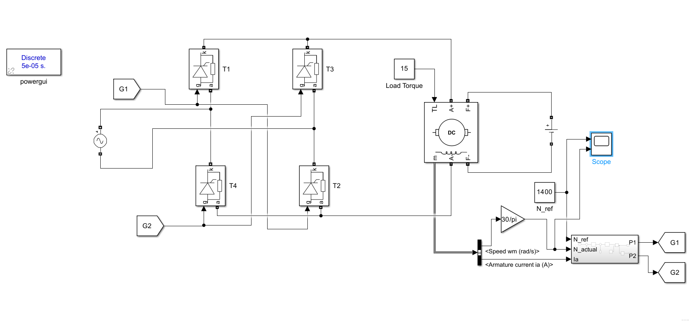
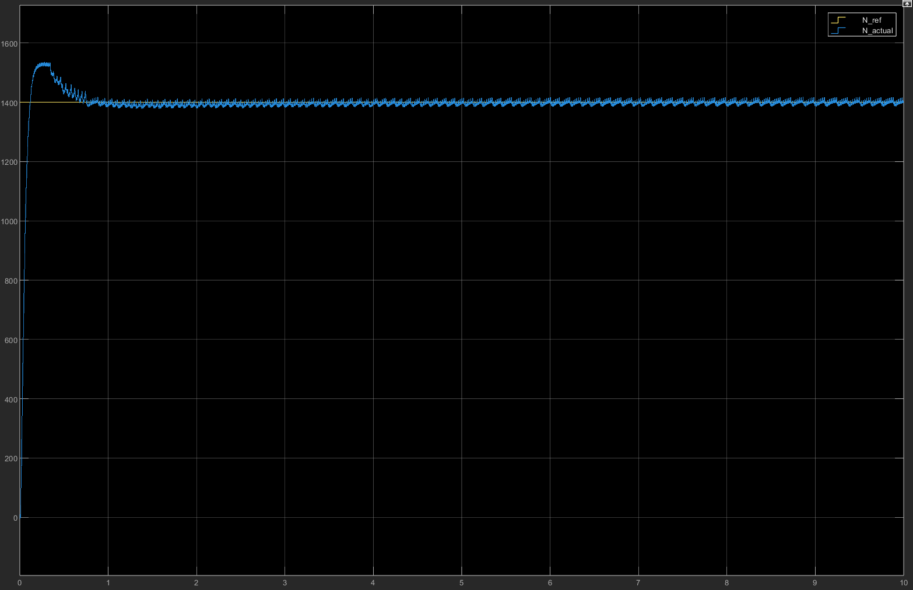

# DC Motor Speed Control Using MATLAB/Simulink

## Overview

This project implements a closed-loop speed control system for a separately excited DC motor using a single-phase thyristor-based controlled converter and a cascaded Proportional-Integral (PI) controller. The system is modelled and simulated in MATLAB/Simulink to analyse the motor's speed response and evaluate controller performance.

The reference speed is set to 1400 RPM. The cascaded PI controller processes both speed and armature current errors to generate firing pulses for the converter, regulating the motor speed under a constant load torque of $15\ \text{N}\cdot\text{m}$.

## Objectives

- Model a separately excited DC motor using MATLAB/Simulink.
- Implement a single-phase fully controlled thyristor bridge converter for motor armature voltage control[cite: 3].
- Develop a closed-loop cascaded speed and current control system using discrete PI controllers[cite: 3, 4].
- Analyse the speed response using rise time, settling time, maximum speed, and percentage overshoot.

## Simulink Model

The following figure shows the top-level closed-loop DC motor speed control model developed in MATLAB/Simulink[cite: 3].



### Cascaded Controller Subsystem

The following figure shows the internal structure of the cascaded discrete PI speed and armature current control loops[cite: 4].


### Gate Pulse Generation Subsystem

The following figure shows the firing pulse generation logic used to produce the triggering signals (`P1`/`G1` and `P2`/`G2`) for the thyristor pairs[cite: 3, 4].


### Main Components

- **Thyristor converter:** A single-phase fully controlled bridge rectifier ($T_1$–$T_4$) that regulates the DC armature voltage supplied to the motor[cite: 3].
- **Separately excited DC motor:** Converts electrical energy into mechanical energy with constant field excitation[cite: 3].
- **Cascaded PI controller:** An outer discrete PI loop processes the speed error ($N_{ref} - N_{actual}$) to generate a current-limited reference, while an inner discrete PI loop regulates the armature current error ($I_{a,ref} - I_a$)[cite: 4].
- **Feedback conditioning:** Extracts motor angular velocity $\omega_m$ (converted to RPM via a $30/\pi$ gain block) and armature current $I_a$[cite: 3].
- **Gate pulse generation subsystem:** Compares the inner controller output against a carrier waveform and uses logic blocks to generate complementary triggering signals ($P_1$/$G_1$ and $P_2$/$G_2$) for the diagonal thyristor pairs ($T_1\text{–}T_2$ and $T_3\text{–}T_4$)[cite: 3, 4].
- **Reference speed:** Set to 1400 RPM[cite: 3].
- **Load torque:** A constant load torque of $15\ \text{N}\cdot\text{m}$ is applied during the simulation[cite: 3].

## Control Strategy

A closed-loop cascaded PI controller is used to regulate the motor speed and limit transient armature current[cite: 4].

The speed error is defined as:

$$e(t) = N_{ref} - N(t)$$

where:

- $N_{ref}$ is the reference speed (1400 RPM)[cite: 3].
- $N(t)$ is the actual motor speed in RPM[cite: 3].
- $e(t)$ is the speed error.

The continuous-time equivalent of the PI controller output is given by:

$$u(t) = K_p e(t) + K_i \int_0^t e(\tau)\,d\tau$$

where $K_p$ and $K_i$ are the proportional and integral gains, respectively.

In the discrete Simulink implementation ($T_s = 50\ \mu\text{s}$), the outer speed `PI(z)` controller outputs a bounded armature current reference $I_{a,ref}$, and the inner current `PI(z)` controller outputs a control signal fed into the gate pulse generation subsystem to regulate the converter's average armature voltage[cite: 3, 4].

## Simulation Results

The following figure shows the motor speed response obtained from the MATLAB/Simulink simulation.



### Performance Analysis

| Parameter | Value |
| :--- | ---: |
| Reference speed | 1400 RPM |
| Maximum speed | 1524 RPM |
| Percentage overshoot | 8.86% |
| Rise time | Approximately 116 ms |
| Settling time | Approximately 750 ms |
| Controller | Cascaded Discrete PI controller |
| Motor type | Separately excited DC motor |
| Converter type | Single-phase thyristor-based controlled converter |
| Load condition | Constant load torque ($15\ \text{N}\cdot\text{m}$) |

### Percentage Overshoot Calculation

The percentage overshoot is calculated as:

$$M_p = \frac{N_{max} - N_{ref}}{N_{ref}} \times 100$$

Substituting the simulation values:

$$M_p = \frac{1524 - 1400}{1400} \times 100$$

Therefore, the percentage overshoot is **8.86%**.

### Observations

- The motor speed initially rises above the reference speed of 1400 RPM.
- The maximum speed reaches approximately 1524 RPM.
- The cascaded PI controller reduces the speed error and brings the motor speed smoothly to the reference value[cite: 4].
- The rise time is approximately 116 ms.
- The motor speed approaches steady state in approximately 750 ms.
- The simulation demonstrates closed-loop speed regulation and transient current limiting using a thyristor-based converter and cascaded PI control[cite: 3, 4].

*Note: Rise time and settling time are approximate values observed from the simulation response. The settling time depends on the tolerance band used.*

## Tools and Technologies

- MATLAB
- Simulink / Simscape Electrical
- Power Electronics
- DC Motor Drives
- Cascaded PI Control

## How to Run the Simulation

1. Clone the repository:

   ```bash
   git clone [https://github.com/FaisalGit-hub/Speed-Control-of-a-DC-Motor.git](https://github.com/FaisalGit-hub/Speed-Control-of-a-DC-Motor.git)
