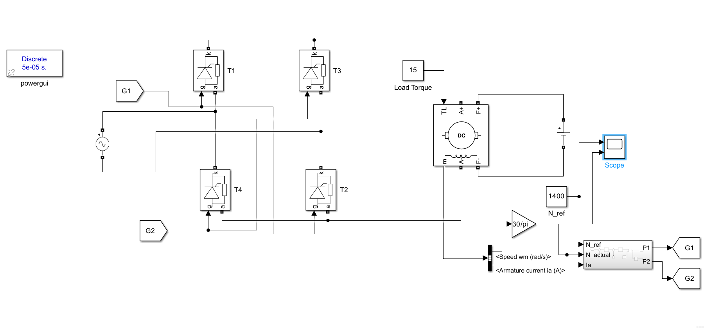
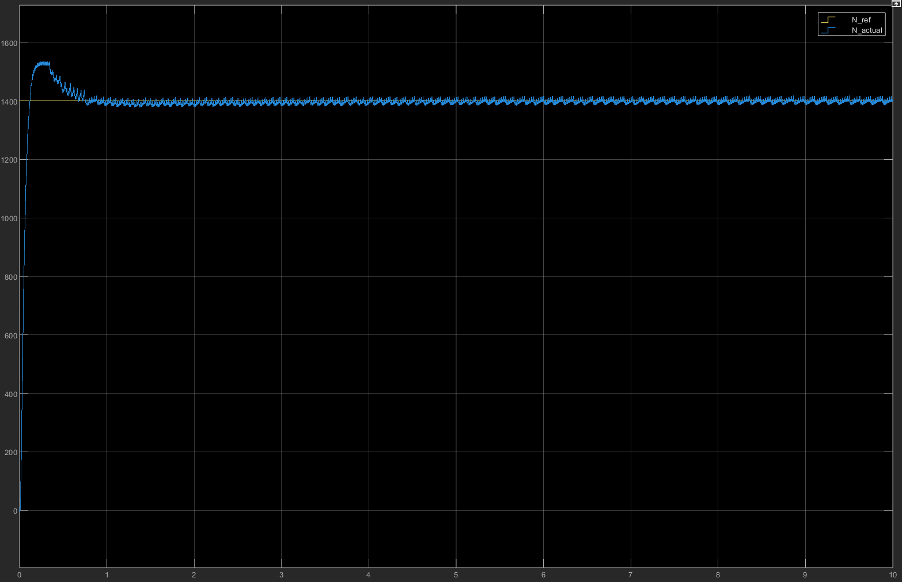

# DC Motor Speed Control Using MATLAB/Simulink

## Overview

This project focuses on the speed control of a separately excited DC motor using a thyristor-based controlled converter and a Proportional-Integral (PI) controller. The system is modelled and simulated in MATLAB/Simulink to study the motor's speed response and evaluate the controller's performance.

The reference speed is set to 1400 RPM, and the controller adjusts the converter firing to regulate the motor speed under a constant load torque.

## Objectives

- Model a separately excited DC motor in MATLAB/Simulink.
- Implement a thyristor-based controlled converter for armature voltage control.
- Design a PI controller for closed-loop speed regulation.
- Analyse the motor speed response using rise time, peak speed, percentage overshoot, and settling time.

## Simulink Model

The following diagram shows the closed-loop DC motor speed control system developed in MATLAB/Simulink.



### Main Components

- **Thyristor converter:** Controls the armature voltage supplied to the motor.
- **Separately excited DC motor:** Converts electrical energy into mechanical energy.
- **PI controller:** Uses the speed error to generate the control action.
- **Speed feedback:** Feeds the measured motor speed back to the controller.
- **Firing pulse generation:** Generates triggering signals for the thyristors.
- **Reference speed:** The desired motor speed is set to 1400 RPM.
- **Load torque:** A constant load torque is applied during simulation.

## Control Strategy

A closed-loop PI controller is used to maintain the motor speed at the reference value.

The speed error is calculated as:

$$
e(t) = N_{\mathrm{ref}} - N(t)
$$

where:

- \(N_{\mathrm{ref}}\) is the reference speed.
- \(N(t)\) is the actual motor speed.
- \(e(t)\) is the speed error.

The PI controller generates the control signal using:

$$
u(t) = K_p e(t) + K_i \int e(t)\,dt
$$

where \(K_p\) and \(K_i\) are the proportional and integral gains, respectively.

The controller output is used by the firing pulse generation circuit to regulate the thyristor converter and control the motor speed.

## Simulation Results

The motor speed response obtained from MATLAB/Simulink is shown below.



### Performance Analysis

| Parameter | Value |
|---|---:|
| Reference speed | 1400 RPM |
| Maximum speed | 1524 RPM |
| Percentage overshoot | 8.86% |
| Rise time | Approximately 116 ms |
| Settling time | Approximately 750 ms |
| Controller | PI controller |
| Motor type | Separately excited DC motor |
| Converter type | Thyristor-based controlled converter |
| Load condition | Constant load torque |

### Percentage Overshoot Calculation

Percentage overshoot is calculated using:

$$
M_p = \frac{N_{\max} - N_{\mathrm{ref}}}{N_{\mathrm{ref}}} \times 100
$$

Substituting the simulated values:

$$
M_p = \frac{1524 - 1400}{1400} \times 100
$$

Therefore, the percentage overshoot is **8.86%**.

### Observations

- The motor speed initially rises above the reference speed of 1400 RPM.
- The maximum speed reaches approximately 1524 RPM.
- The PI controller reduces the speed error and brings the motor speed towards the reference value.
- The speed response approaches steady state in approximately 750 ms.
- The response demonstrates closed-loop speed regulation using a thyristor converter and a PI controller.

*Note: Rise time and settling time are approximate values observed from the simulation response. Settling time depends on the tolerance band used.*

## Tools and Technologies

- MATLAB
- Simulink
- Power Electronics
- DC Motor Drives
- PI Control

## How to Run the Simulation

1. Clone or download this repository:

   ```bash
   git clone https://github.com/FaisalGit-hub/Speed-Control-of-a-DC-Motor.git
   ```

2. Open MATLAB and navigate to the project directory.
3. Open the Simulink model file.
4. Check the reference speed, PI controller parameters, and load torque settings.
5. Run the simulation.
6. Observe the motor speed response using the Scope and compare it with the reference speed.

## Repository Structure

```text
Speed-Control-of-a-DC-Motor/
├── README.md
├── [Simulink model file]
└── results/
    ├── block_diagram.png
    └── speed_response.png
```

Replace `[Simulink model file]` with the actual name of your saved model file.

## Conclusion

A closed-loop speed control system for a separately excited DC motor was modelled and simulated using MATLAB/Simulink. A thyristor-based controlled converter and PI controller were used to regulate the motor speed at a reference of 1400 RPM. The simulation produced a maximum speed of 1524 RPM, a percentage overshoot of 8.86%, a rise time of approximately 116 ms, and a settling time of approximately 750 ms.

The project demonstrates the application of power electronics and PI control in DC motor drive speed regulation.
